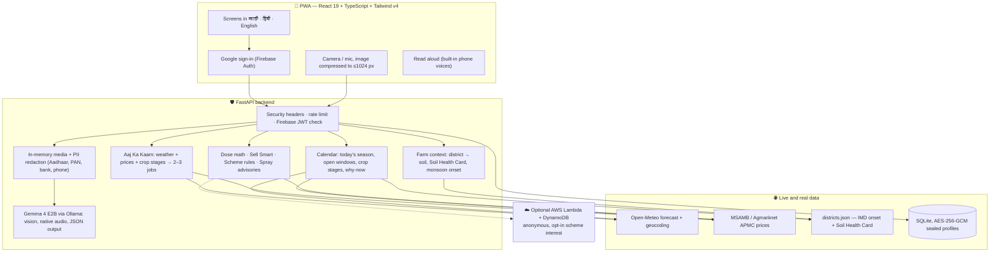

<div align="center">


# Arth · अर्थ

### *"What should I do on my farm today?"*

**Answered every morning for smallholder farmers in Maharashtra, in मराठी, हिंदी and English.**

<sub>आज शेतात काय करू? · आज खेत में क्या करूँ?</sub>

<br>

[](https://alt-soul-absolutely-compliance.trycloudflare.com)
[](#-run-it-locally)

[](LICENSE)
[](frontend/)
[](frontend/)
[](frontend/)
[](backend/)
[](backend/pyproject.toml)
[-ff6f00?style=flat-square)](https://ai.google.dev/gemma)
[](backend/tests/)
[](frontend/vite.config.ts)

</div>

> [!NOTE]
> **The live demo runs on our team laptop**, where Gemma 4 runs locally. It is up while that laptop
> is on. Sign in with Google. If the link doesn't load, follow [Run it locally](#-run-it-locally) —
> it takes about ten minutes.

---

## 🌾 Why Arth exists

A small farmer in Nashik or Latur makes dozens of decisions a week with very little help:
*Is it safe to spray tomorrow? How much of this pesticide goes in my 16-litre tank? Should I sell
my onions at Lasalgaon today or wait? Which government scheme am I eligible for? What does this
bank letter mean?*

The answers exist — in weather models, APMC price boards, soil test records, scheme rules, the
small print on a pesticide label — but they are scattered, in English, and not about *his* farm.

**Arth brings them together into two or three jobs for today**, on a cheap phone, in the farmer's
own language, spoken aloud if he prefers to listen. There is no demo mode and no sample data:
after Google sign-in, everything on screen is real and current.

<table>
<tr>
<td align="center" width="25%"><h3>🌦️</h3><b>Live weather</b><br><sub>Open-Meteo, 7-day forecast, spray and heat rules</sub></td>
<td align="center" width="25%"><h3>💰</h3><b>Live mandi prices</b><br><sub>MSAMB / Agmarknet, net earning after transport</sub></td>
<td align="center" width="25%"><h3>🌱</h3><b>9.26 lakh soil tests</b><br><sub>Soil Health Card results for all 36 districts</sub></td>
<td align="center" width="25%"><h3>🌧️</h3><b>40 years of rainfall</b><br><sub>IMD gridded data, monsoon onset per district</sub></td>
</tr>
</table>

---

## 📑 Contents

| | | |
| :--- | :--- | :--- |
| 🌾 [Why Arth exists](#-why-arth-exists) | 🧭 [How Arth knows without asking](#-how-arth-knows-things-without-asking) | 💻 [Run it locally](#-run-it-locally) |
| 📱 [What a farmer sees](#-what-a-farmer-sees) | 🏗️ [Architecture](#️-architecture) | 🔌 [API](#-api) |
| ✨ [Features in depth](#-features-in-depth) | 📊 [Real data, no sample data](#-real-data-no-sample-data) | 🗂️ [Repository layout](#️-repository-layout) |
| 🛡️ [The safety rule](#️-the-safety-rule) | 🔒 [Privacy and security](#-privacy-and-security) | 🧪 [Testing](#-testing) |
| 📜 [Models, tools and licenses](#-models-tools-and-licenses) | ⚖️ [What we built vs. what tools did](#️-what-we-built-vs-what-tools-did) | 👥 [Team and credits](#-team) |

---

## 📱 What a farmer sees

| Screen | What it does | Where the answer comes from |
| :--- | :--- | :--- |
| 🔐 **Sign in** | Dawn rising over layered hills, the wordmark, a tagline that cycles through three languages, then **Sign in with Google** — the only way in. | Firebase Auth |
| 🏠 **Home — Aaj Ka Kaam** | The sky right now over the farm, how far into the sowing season we are, the **single most important job today** in big type, where each of the farmer's crops usually stands this week, 4-day weather and price moves. One button reads it all aloud. | Open-Meteo · mandi prices · crop-stage calendar |
| 📅 **Crop calendar** | A **year map** of the farm (seasons, each crop's stages, the monsoon, a line at today), what is in the field now, which crops can be sown **today** (with days left) and which windows open soon — each with a *why now*. | Today's date · IMD monsoon onset · Soil Health Card |
| 🩺 **Crop Doctor** | Photo of a sick leaf → disease, severity, organic and chemical remedies, prevention. Below 60 % confidence it says *"not sure"* and offers the Kisan Call Centre. | Gemma 4 vision |
| 🏷️ **Label Reader** | Photo of a pesticide label → the dose for *this farmer's* sprayer tank, waiting period, safety. **Never guesses a dose.** | Gemma 4 reads · Python calculates |
| 📈 **Mandi & Sell Smart** | Nearby APMC prices, 30-day trend, and *sell now or wait* after the cost of trucking to each market. | MSAMB / Agmarknet · Open-Meteo geocoding |
| 📄 **Kagaz Samjho** | Photo of a government or bank paper → plain-language summary, deadlines, next steps. Aadhaar, PAN and bank numbers are hidden **first**. | PII redaction + Gemma 4 |
| 🏛️ **Schemes** | One question per screen → the central and Maharashtra schemes he qualifies for, why, and which documents to carry. | Deterministic rules engine |
| 🎙️ **Voice** | Ask anything by voice from any screen; Arth answers, navigates or fills the form. | Gemma 4 native audio |
| 👤 **Profile** | Who you are, your farm, **your district's soil test results**, shortcuts. | Profile + Soil Health Card |
| ⚙️ **Settings** | Language, alerts, sprayer tank, soil correction, optional "about you", help, privacy and data, delete account. | — |

---

## ✨ Features in depth

<details open>
<summary><b>🏠 Aaj Ka Kaam — today's jobs, ranked</b></summary>
<br>

The home screen answers one question at a glance. The backend ([`services/brief.py`](backend/app/services/brief.py))
combines the live forecast, live prices and the crop-stage calendar into **two or three actions
sorted by priority** — spray, irrigate, harvest, sell, sow, protect or apply for a scheme — each
with a button that opens the right screen. Weather rules ([`services/weather.py`](backend/app/services/weather.py)) are plain thresholds:

| Rule | Trigger |
| :--- | :--- |
| 🌧️ Don't spray | rain probability **> 60 %** (danger at **≥ 80 %**) |
| 💨 Don't spray | wind **> 20 km/h** |
| 🔥 Irrigate | max temperature **≥ 38 °C** |

</details>

<details>
<summary><b>📅 A calendar that runs on today's date</b></summary>
<br>

- Knows the current season (**kharif · rabi · zaid**) in IST and how many days are left.
- Shows what each of the farmer's crops is **usually** doing this week — nursery, transplanting,
  protection, harvest, rest — for 12 crops: onion, soybean, cotton, grapes, pomegranate, sugarcane,
  wheat, gram, maize, tomato, potato and watermelon ([`crop_stages.json`](backend/app/data/crop_stages.json)).
- Lists which sowing windows are **open now** and which open soon, ranked by suitability for the
  farm's soil and water.
- **Kharif windows move with the district's own monsoon onset**, computed from 40 years of IMD rainfall.
- *Why now* lines come from the live forecast, live prices and district soil data.

</details>

<details>
<summary><b>🏷️ Label Reader — the dose, never a guess</b></summary>
<br>

Gemma 4 reads the label (product, active ingredient, formulation, printed dose). Then
[`services/dose.py`](backend/app/services/dose.py) — pure Python, unit-tested — converts units and
scales the printed rate to the farmer's tank. Doses above 50 g or 50 ml per litre, or tanks outside
1–1000 L, are rejected. If the label has no readable dose, the answer is **no dose** plus the
Kisan Call Centre, never an estimate.

</details>

<details>
<summary><b>📈 Sell Smart — sell now or wait?</b></summary>
<br>

[`services/mandi.py`](backend/app/services/mandi.py) pulls APMC prices from **MSAMB** (no key needed)
or **Agmarknet on data.gov.in** (with a free key), and stores them daily so a trend builds up.

- Markets within **250 km**; straight-line distance × **1.3** for road distance.
- Transport estimated at **₹2 per quintal per km** (configurable, shown as an estimate).
- Trend slope by least squares over the last 7 days.
- Recommends **WAIT** only when prices are clearly rising (**> 0.5 % a day**) *and* the crop keeps —
  perishables like tomato and grapes are always **SELL NOW**.
- Gemma only writes the explanation in the farmer's language; the decision is code.

</details>

<details>
<summary><b>🏛️ Schemes — eligibility by rules, not by a chatbot</b></summary>
<br>

[`services/schemes.py`](backend/app/services/schemes.py) evaluates eight answers (land, category,
bank account, Aadhaar, irrigation, income tax, …) against the rules in
[`schemes.json`](backend/app/data/schemes.json):

PM-KISAN · Namo Shetkari Mahasanman Nidhi · PM Fasal Bima Yojana · Kisan Credit Card ·
PMKSY Per Drop More Crop · Soil Health Card · MahaDBT farm mechanisation ·
Dr. Babasaheb Ambedkar Krishi Swavalamban Yojana

Every result says **why** the farmer is or isn't eligible, the benefit, the documents to carry and
the official link.

</details>

<details>
<summary><b>🎙️ Voice-first, in three languages</b></summary>
<br>

- **Listening:** up to 15 seconds of audio, decoded in memory with PyAV to 16 kHz and transcribed
  by Gemma 4's own audio input (or faster-whisper on CPU as an option). The farmer's own village
  and district are passed as spelling hints.
- **Understanding:** the reply can answer a question, open a screen, or fill a form field.
- **Speaking:** every answer can be read aloud with the phone's built-in voices (`mr-IN`, `hi-IN`,
  `en-IN`). Many phones have no Marathi voice, so Marathi falls back to a Hindi voice (same
  Devanagari script), and the app explains what to install when no voice exists.

</details>

---

## 🧭 How Arth knows things without asking

Onboarding is **six questions** — language, name, place, crops, land and water. Soil is never asked.
From the farm's location, Arth works out the rest:

```
 phone location (rounded to ~1 km)  ──►  nearest of 36 Maharashtra districts
                                              │
          ┌───────────────────────────────────┼─────────────────────────────────┐
          ▼                                   ▼                                 ▼
  dominant soil type              Soil Health Card results            monsoon onset (IMD 1985–2025)
  (black / red / laterite /       share of tested fields low in       Theil–Sen trend + Mann–Kendall
   alluvial)                      N, P, K, organic carbon, S, Zn…     significance, per district
          │                                   │                                 │
          ▼                                   ▼                                 ▼
  crop suitability                "87% of fields in Ahmednagar        kharif sowing windows move with
                                   are low in nitrogen"                this district's rain
```

- **District data** lives in [`districts.json`](backend/app/data/districts.json), built by
  [`build_districts.py`](backend/scripts/build_districts.py) from the Project Rutu data pipeline.
- **Monsoon onset** = the first day from 1 June on which the next 7 days bring ≥ 25 mm, with no dry
  spell longer than 7 days in the following 30 days. The trend is a Theil–Sen slope, tested with
  Mann–Kendall (p < 0.05).
- **Soil** is the **district's odds, not the farmer's field** — the app says so plainly and points
  to a free Soil Health Card test. A farmer can correct his soil type in Settings and it is kept.
- **Water** takes several answers (e.g. rainfed + borewell); advice follows the most controlled
  source: drip › sprinkler › borewell › canal › rainfed.

---

## 🛡️ The safety rule

> [!IMPORTANT]
> **The model reads and explains. Plain, tested code decides.**

| 🧠 Gemma 4 does | 🧮 Deterministic Python does |
| :--- | :--- |
| Reads a leaf, a label, a document, a voice note | Pesticide dose per tank |
| Returns schema-validated JSON | Sell now or wait |
| Explains a result in Marathi, Hindi or English | Scheme eligibility |
| | Sowing windows and crop stages |
| | Spray, wind and heat advisories |

Low confidence, an unreadable label, or anything unsure → no guess, only the
**Kisan Call Centre · 📞 [1800-180-1551](tel:18001801551)**.

---

## 🏗️ Architecture



<details>
<summary><b>☁️ About the optional cloud sync</b></summary>
<br>

[`aws/sync_lambda.py`](aws/sync_lambda.py) stores **anonymous** scheme-interest records in DynamoDB,
and only when a farmer ticks the opt-in. A record is the scheme, district, main crop, a land-size
band, language and day — **no name, village, phone, Aadhaar, bank or user ID**. Any other field
fails the whole batch. The Lambda has `PutItem` permission only, so it cannot read records back:
a leaked secret leaks no data. Only the backend calls it, never the browser.

</details>

---

## 📊 Real data, no sample data

| What | Source | Freshness |
| :--- | :--- | :--- |
| Weather, 7-day forecast | [Open-Meteo](https://open-meteo.com) | live, cached 15 min |
| Mandi prices, 30-day trend | [MSAMB](https://www.msamb.com) APMC prices (no key), or Agmarknet on [data.gov.in](https://data.gov.in) with a key | live, stored daily so the trend builds up |
| Market locations and distances | Open-Meteo geocoding | live, cached |
| Monsoon onset per district | IMD Pune gridded daily rainfall 0.25°, 1985–2025 | built offline (`build_districts.py`) |
| District soil (N, P, K, OC, S, Zn, B, Fe) | Soil Health Card Nutrient Dashboard — **9,26,473 samples**, cycles 2023-24 to 2025-26 | latest completed cycle per district |
| Crop stages and sowing windows | Maharashtra crop calendars (state department, MPKV, NRC Grapes) | reviewed by hand |
| Photo, label, document, voice | Gemma 4 E2B, running locally via Ollama | per request, never stored |

---

## 💻 Run it locally

### Prerequisites

| Tool | Version | Notes |
| :--- | :--- | :--- |
| **Node.js** + npm | 20+ | frontend |
| **Python** | 3.11 – 3.14 | backend |
| **[Ollama](https://ollama.com)** | latest | then `ollama pull gemma4:e2b` (needs about 3 GB of VRAM) |
| **Firebase** project | free tier | Google sign-in enabled |
| **data.gov.in** API key | optional | mandi prices work without one, from MSAMB |

### 1 · Firebase (Google sign-in)

1. Create a project at <https://console.firebase.google.com>.
2. **Authentication → Sign-in method → Google → Enable.**
3. **Authentication → Settings → Authorized domains**: add `localhost` (and any deployed domain).
4. **Project settings → Your apps → Web app**: copy `apiKey`, `authDomain`, `projectId`, `appId`.

### 2 · Backend

```bash
cd backend
python -m venv .venv
.venv\Scripts\activate          # Windows
# source .venv/bin/activate     # macOS / Linux
pip install -e ".[dev]"
cp .env.example .env            # set ARTH_FIREBASE_PROJECT_ID (and optionally ARTH_DATA_GOV_IN_API_KEY)
uvicorn app.main:app_factory --factory --port 8000
```

API docs (development only): <http://localhost:8000/docs>

### 3 · Frontend

```bash
cd frontend
npm install
cp .env.example .env.local      # fill in the four VITE_FIREBASE_* values
npm run dev
```

Open <http://localhost:5173>, choose a language and **Sign in with Google**. `npm run dev` proxies
`/api` to the backend on port 8000, so the browser sees one origin.

<details>
<summary><b>🚀 One-address demo mode and a public link (Windows)</b></summary>
<br>

| Script | What it does |
| :--- | :--- |
| [`scripts/demo.ps1`](scripts/demo.ps1) | Builds the web app, then serves the app **and** the API from `http://localhost:8000` — one origin, no CORS, and the offline service worker works. |
| [`scripts/tunnel.ps1`](scripts/tunnel.ps1) | Opens a temporary public HTTPS link (Cloudflare quick tunnel, or localhost.run over SSH). Add the printed host to Firebase **Authorized domains**. |
| [`scripts/keep-awake.ps1`](scripts/keep-awake.ps1) | Keeps the laptop awake while the public link runs; changes no settings. |

</details>

<details>
<summary><b>🗺️ Rebuilding the district data (optional)</b></summary>
<br>

```bash
git clone https://github.com/rushii23-dev/Project-Rutu ../Project-Rutu
cd backend
python scripts/build_districts.py ../../Project-Rutu
```

</details>

---

## 🔌 API

Full contract: [`docs/SPEC.md`](docs/SPEC.md). Every request carries the Firebase ID token; the user
ID is taken **only** from the verified token. JSON is camelCase, money is whole ₹, prices are ₹/quintal.

| Method | Path | Returns |
| :--- | :--- | :--- |
| `GET` `PUT` `DELETE` | `/farmer/me` | The profile. `soilType` comes from the district unless the farmer set it (`soilSource: "farmer"`). Delete removes the profile and all history. |
| `GET` | `/brief?lang=` | Greeting, place, weather now, 4-day weather, 2–3 actions, price alerts, crops in the field today, season progress. |
| `GET` | `/calendar?lang=[&season=]` | Year map, monsoon onset, crops in the field, recommendations with open / upcoming status and *why now*. |
| `GET` | `/soil?lang=[&lat=&lon=&district=]` | District soil type and Soil Health Card shares, with plain-language tips. |
| `GET` | `/weather?lat=&lon=&lang=` | Current conditions, 7 days, spray / heat / wind advisories. |
| `GET` | `/mandi/prices` | Nearby markets and the 30-day trend. |
| `POST` | `/mandi/sell-advice` | Sell now or wait, after transport, with every option. |
| `POST` | `/ai/crop-doctor` · `/ai/label-reader` · `/ai/explain-document` · `/ai/voice` | Gemma 4 results (multipart). |
| `POST` | `/schemes/match` | Schemes with eligibility reasons, benefits and documents. |

Errors always look like `{ "error": { "code": "...", "message": "..." } }`.

---

## 🗂️ Repository layout

```
Arth/
├── frontend/                         React 19 PWA
│   └── src/
│       ├── app/                      router, layout, bottom nav, mic
│       ├── features/
│       │   ├── auth/                 Google sign-in screen, consent
│       │   ├── onboarding/           6 questions, soil found from location
│       │   ├── brief/                Home: TodayHero, top job, crops today
│       │   ├── calendar/             YearMap, FieldCropCard, sow-now list, week plans
│       │   ├── profile/              Profile, SoilCard, SettingsPage and its sections
│       │   └── doctor/ label/ kagaz/ mandi/ schemes/ weather/
│       ├── components/               shared UI and voice (listen + read aloud)
│       ├── lib/                      typed API client, Firebase, session
│       └── i18n/                     en / hi / mr
├── backend/
│   ├── app/
│   │   ├── services/                 farm, calendar, brief, weather, mandi, dose, schemes, ai, sync…
│   │   ├── prompts/                  every prompt Gemma sees, as readable text files
│   │   ├── data/                     districts, crop stages, crops, schemes (JSON)
│   │   ├── pii.py  media.py  stt.py  in-memory privacy pipeline
│   │   └── db.py                     AES-256-GCM sealed SQLite store
│   ├── scripts/build_districts.py    rebuilds district data
│   └── tests/                        268 tests, no network or model needed
├── aws/sync_lambda.py                optional anonymous, opt-in cloud sync
├── scripts/                          demo, public tunnel, keep-awake (Windows)
└── docs/SPEC.md                      API contract, security and UX rules
```

---

## 🔒 Privacy and security

| # | Promise | How |
| :---: | :--- | :--- |
| 1 | **Google sign-in only** | Backend verifies the Firebase RS256 token; the user ID comes only from it. |
| 2 | **Photos and voice are never stored** | Decoded in memory, EXIF and GPS stripped, discarded. |
| 3 | **PII is redacted first** | Aadhaar (with Verhoeff checksum), PAN, IFSC, bank account, phone, email — before anything reaches Gemma, a log, a response or storage. |
| 4 | **Gemma never sees who you are** | Only crop, district, season, numbers and the media — never name, email, phone, user ID or address. |
| 5 | **Location is rounded to ~1 km** | On the phone and on the server. |
| 6 | **Profiles are encrypted** | AES-256-GCM, row-bound; user keys are HMAC-hashed; history has a 30-day TTL. |
| 7 | **Delete means delete** | Removes the profile, all history and the Google account link. |
| 8 | **Locked-down web layer** | Strict CSP, `X-Frame-Options: DENY`, rate limit 10 rps (burst 20), the service worker never caches `/ai/*`. |

---

## 🧪 Testing

```bash
cd backend
pytest              # 268 tests: rules, dose, PII, auth, soil, calendar, mandi, sync, API contract
ruff check .

cd ../frontend
npm run lint
npm run build       # strict type-check + production build
```

The backend suite needs **no network and no model** — external services are faked — so it runs in
about 20 seconds on a laptop.

---

## 📜 Models, tools and licenses

| Component | Role in Arth | License |
| :--- | :--- | :--- |
| **[Gemma 4 E2B](https://ai.google.dev/gemma)** | Vision (leaf, label, document), native audio, explanations — schema-validated JSON | Apache 2.0 (open weights) |
| **[Ollama](https://ollama.com)** | Local model runtime | MIT |
| **[faster-whisper](https://github.com/SYSTRAN/faster-whisper)** | Optional CPU speech-to-text | MIT |
| **[PyAV](https://github.com/PyAV-Org/PyAV)** | In-memory audio decoding to 16 kHz | BSD-3-Clause |
| **Web Speech API** | Reading answers aloud on the phone | Browser / OS built-in |
| **React 19 · Vite · Tailwind v4 · TanStack Query · i18next · Recharts** | Frontend | MIT |
| **FastAPI · Pydantic · httpx · Pillow · cryptography · PyJWT** | Backend | MIT / BSD / HPND / Apache 2.0 |
| **Firebase Auth** | Google sign-in | Google service terms |
| **[Open-Meteo](https://open-meteo.com)** | Weather and geocoding | CC BY 4.0 |
| **Agmarknet via [data.gov.in](https://data.gov.in)** | Mandi prices | Government Open Data License – India |
| **Arth's own code** | Everything in this repository | [Apache 2.0](LICENSE) |

---

## ⚖️ What we built vs. what tools did

<table>
<tr>
<th width="50%">🛠️ Engineered by our team</th>
<th width="50%">🤖 Handled by models and off-the-shelf tools</th>
</tr>
<tr valign="top">
<td>

- **Agronomy engines** in `backend/app/services/`: tank-dose scaling, Sell Smart net earnings,
  the scheme rules engine, spray / heat / wind advisories, sowing windows that follow each
  district's monsoon onset.
- **District model**: soil type, Soil Health Card shares and monsoon-onset trends for 36 districts.
- **Privacy pipeline**: Verhoeff-checked Aadhaar detection, PAN / IFSC / account / phone / email
  redaction, EXIF and GPS stripping, zero-disk media handling.
- **Encrypted storage**: AES-256-GCM row-bound SQLite, HMAC keys, 30-day TTL, full deletion.
- **The whole PWA**: trilingual UI, voice-first flows, year map, offline-ready shell.
- **268 automated tests** and the locked-down sync Lambda.

</td>
<td>

- **Gemma 4 E2B** reads photos and voice into structured JSON and writes explanations in the
  farmer's language.
- **Open-Meteo, MSAMB and Agmarknet** supply live weather and prices.
- **IMD and Soil Health Card** open data supply rainfall and soil records.
- **Firebase** handles Google sign-in.
- **AI coding assistants** helped with drafting and checks; the architecture, the domain rules,
  the security design and every line merged were reviewed by the team.

</td>
</tr>
</table>

---

## 👥 Team

<table>
<tr>
<td align="center"><a href="https://github.com/AmanDadsena"><br><b>Aman Dadsena</b></a></td>
<td align="center"><a href="https://github.com/rushii23-dev"><br><b>rushii23-dev</b></a></td>
<td align="center"><a href="https://github.com/MohanishDas07"><br><b>Mohanish Das</b></a></td>
</tr>
</table>

## 🙏 Data sources and credits

- **Design system and the location-first approach:** [Project Rutu](https://github.com/rushii23-dev/Project-Rutu) — tokens, type, cards, bottom nav, and the district monsoon and Soil Health Card pipeline.
- **Rainfall:** India Meteorological Department, Pune — gridded daily rainfall 0.25°.
- **Soil:** Soil Health Card scheme, Ministry of Agriculture & Farmers Welfare — [Nutrient Dashboard](https://soilhealth.dac.gov.in/nutrient-dashboard).
- **Weather:** [Open-Meteo](https://open-meteo.com) (CC BY 4.0).
- **Mandi prices:** [MSAMB](https://www.msamb.com) and DMI Agmarknet via [data.gov.in](https://data.gov.in).
- **Fonts:** Inter, Anek Devanagari and Tiro Devanagari Hindi (SIL Open Font License, bundled in [`frontend/public/fonts`](frontend/public/fonts)).
- **Helpline:** Kisan Call Centre, 1800-180-1551.

---

<div align="center">

**Apache 2.0** — see [LICENSE](LICENSE)

<sub>Made for the farmers of Maharashtra · महाराष्ट्रातील शेतकऱ्यांसाठी 🌾</sub>

</div>
