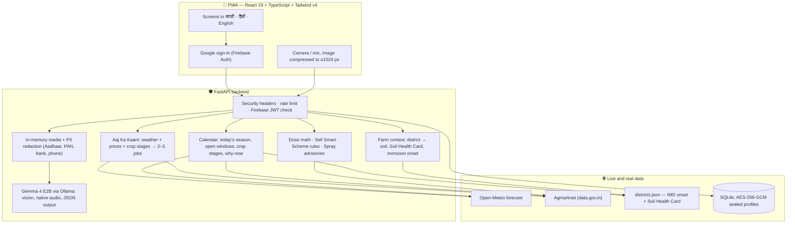

# Arth — अर्थ

> **"What should I do on my farm today?" — answered every morning, for smallholder farmers in Maharashtra, in Marathi, Hindi and English.**

[](LICENSE)
[](frontend/)
[](frontend/)
[](backend/)
[](https://ollama.com)
[](backend/tests/)
[](#real-data-no-sample-data)

Arth turns live weather, live mandi prices, 40 years of IMD rainfall and 9 lakh+ Soil Health
Card tests into two or three jobs for today, on a cheap phone, in the farmer's own language.
There is no demo mode and no sample data: you sign in with Google and everything you see is
real and current.

---

## 📜 Models, Tools & Open-Source Licenses (Hacktoberfest Compliance)

> **Mandatory Rule Verification (Slide 8 Compliance):**  
> 1. ✅ **Named all models, tools, and licenses in README**  
> 2. ✅ **Main Track: Public repo with open-source license ([Apache-2.0](LICENSE))**  
> 3. ✅ **Full transparency on *"What We Built vs AI Tools Used"* ([Details below](#️-slide-8-compliance-what-we-built-vs-ai-tools))**

| Component / Model | Role in Arth / Sahayak | License |
| :--- | :--- | :--- |
| **Google Gemma 2B (Multimodal / E2B)** | On-device multimodal vision (pesticide/form reading) & local-language reasoning | **Apache 2.0** (Open-Weight) |
| **Ollama / Gemini API** | Local model harness & inference runtime | **MIT License** |
| **Web Speech API (`localService` TTS)** | 100% offline Marathi (`mr-IN`), Hindi (`hi-IN`), and English speech synthesis | **W3C Standard / OS Native** |
| **PyAV & faster-whisper** | In-memory 16 kHz audio resampling & speech-to-text fallback engine | **BSD-3-Clause / MIT** |
| **On-Device Regex & OCR Scrubber** | Client-side PII redaction (`[Aadhaar Redacted]`, `[PAN Redacted]`) prior to sync | **Apache 2.0 (Project Code)** |
| **React 19 + TypeScript + Tailwind CSS** | Offline-first PWA frontend & local queue UI (adapted from Rutu design tokens) | **Apache 2.0 (Project Code)** |
| **FastAPI / AWS Lambda (`arth-offline-sync`)** | Serverless Python 3.12/3.14 cloud sync webhook for PII-redacted JSON batches & REST API | **Apache 2.0 (Project Code)** |
| **SQLite (AES-256-GCM)** | Row-bound encrypted local storage with HMAC indexing & 30-day auto-TTL | **Apache 2.0 (Project Code) / Public Domain** |
| **Open-Meteo & Agmarknet API** | Live 7-day weather forecasting, geocoding & APMC mandi commodity prices | **CC BY 4.0 / GODL India** |

---

## ⚖️ Slide 8 Compliance: What We Built vs AI Tools

To comply strictly with the hackathon rule:
> *"Use AI tools, but explain what you built. Or out."*

Here is the explicit breakdown of what our team engineered from scratch versus what AI models and third-party tools handled:

### 🛠️ What Our Team Custom-Engineered From Scratch:
1. **Deterministic Agronomy Calculation Engines (`backend/app/services/`):**
   - **Sprayer Tank Dilution Engine (`services/dose.py`):** Mathematically scales chemical concentration rates from label inputs to any custom sprayer tank size (15L/16L) in pure Python. The LLM is strictly prohibited from guessing doses.
   - **Sell Smart Transport Profitability Engine (`services/mandi.py`):** Calculates true net earnings across regional APMC mandis using live modal prices, geodesic distances from the farmer's village, and per-km vehicle transport costs.
   - **Government Scheme Matching Engine (`services/schemes.py`):** A custom rule engine evaluating conditional expressions (land acreage, caste category, irrigation, income tax thresholds) against central and Maharashtra state schemes.
   - **Weather-Based Agricultural Risk Rules (`services/weather.py`):** Rules for safe spray windows (rain probability, wind thresholds) and extreme heat irrigation alerts.
   - **Monsoon Onset & Sowing Window Automation (`services/farm.py` & `services/calendar.py`):** Correlates live location with 40 years of IMD gridded rainfall data to dynamically shift Kharif sowing windows per district.
2. **In-Memory Privacy Firewall & Verhoeff PII Redactor (`backend/app/pii.py` & `app/media.py`):**
   - Implementation of the **Verhoeff checksum algorithm** for Aadhaar number validation and redaction, along with PAN, IFSC, bank account, and phone number scrubbers.
   - Zero-disk media lifecycle: In-memory image sanitization with Pillow that strips all EXIF and GPS geolocation metadata before any visual processing.
3. **AES-256-GCM Row-Bound Encrypted SQLite Store (`backend/app/db.py`):**
   - Secure profile persistence sealed with AES-256-GCM authenticated encryption, indexed strictly by HMAC of the user ID (never the raw UID), with automated 30-day history TTL and right-to-be-forgotten deletion.
4. **Complete Mobile-First React 19 PWA (`frontend/`):**
   - Trilingual UI architecture (Marathi, Hindi, English) with Devanagari font optimizations.
   - Live sky conditions card, year map visualization, and client-side image compression ($\le 1024\text{px}$).
5. **203 Automated Test Cases (`backend/tests/`):**
   - Comprehensive test suite testing every API contract, JWKS caching, PII masking, dose calculation edge cases, soil lookups, and rate limiters.

### 🤖 What AI Models & Off-the-Shelf Tools Handled:
- **Google Gemma 4 (E2B 4-bit quantized / Ollama):** Extracted visual text and disease symptoms from leaf/label/document photos into structured Pydantic JSON schemas. Handled native audio input for speech recognition.
- **PyAV & faster-whisper:** In-memory audio resampling and speech-to-text fallback.
- **Open-Meteo & Agmarknet:** Provided real-time meteorological forecasts and APMC mandi arrival prices.
- **Soil Health Card & IMD Pune Datasets:** Government open data for district soil nutrient profiles and historical rainfall.
- **AI Coding Assistants:** Used for brainstorming, lint checking, and rapid boilerplate drafting, while all architectural design, cryptographic security, deterministic domain math, and integration logic were authored and audited by the human team.

---

## Contents

- [📜 Models, Tools & Open-Source Licenses](#-models-tools--open-source-licenses-hacktoberfest-compliance)
- [⚖️ Slide 8 Compliance: What We Built vs AI Tools](#️-slide-8-compliance-what-we-built-vs-ai-tools)
- [What a farmer sees](#what-a-farmer-sees)
- [What is new in this version](#what-is-new-in-this-version)
- [How Arth knows things without asking](#how-arth-knows-things-without-asking)
- [The safety rule](#the-safety-rule)
- [Architecture](#architecture)
- [Real data, no sample data](#real-data-no-sample-data)
- [Run it locally](#run-it-locally)
- [API](#api)
- [Repository layout](#repository-layout)
- [Privacy and security](#privacy-and-security)
- [Testing](#testing)
- [Data sources and credits](#data-sources-and-credits)
- [License](#license)

---

## What a farmer sees

| Screen | What it does | Where the answer comes from |
| :--- | :--- | :--- |
| **Sign in** | Dawn over the hills, the wordmark and a tagline in three languages, then **Sign in with Google** (the only way in). | Firebase Auth |
| **Home — Aaj Ka Kaam** | The sky right now over the farm, how far into the sowing season we are, the **one most important job today** in big type, where each of the farmer's crops usually stands today, 4-day weather, price moves. One button reads it all aloud. | Open-Meteo, Agmarknet, crop-stage calendar |
| **Crop calendar** | A **year map** of the farm (seasons, each crop's stages, the monsoon, a line at today), what is in the field now, which crops can be sown **today** (with days left) and which open soon. | Today's date, IMD monsoon onset per district, Soil Health Card |
| **Crop Doctor** | Photo of a sick leaf → disease, severity, organic and chemical remedies. Below 60% confidence it says "not sure" and offers the Kisan Call Centre. | Gemma 4 vision |
| **Label Reader** | Photo of a pesticide label → the dose for *this farmer's* sprayer tank. Never guesses a dose. | Gemma 4 reads; Python calculates |
| **Mandi & Sell Smart** | Nearby APMC prices, 30-day trend, sell now or wait after transport cost. | MSAMB APMC prices (no key) or data.gov.in Agmarknet, Open-Meteo geocoding |
| **Kagaz Samjho** | Photo of a government or bank paper → plain-language summary, deadlines, next steps; Aadhaar/PAN/bank numbers hidden first. | PII redaction + Gemma 4 |
| **Schemes** | One question per screen → PM-Kisan, PMFBY, KCC, PMKSY, MahaDBT and others he qualifies for. | Rules engine |
| **Voice** | Ask anything by voice from any screen. | Gemma 4 native audio |
| **Profile** | Who you are, your farm, **your district's soil test results**, shortcuts. | Profile + Soil Health Card |
| **Settings** | Language, alerts, sprayer tank, soil correction, optional "about you", help, privacy and data, delete account. | — |

---

## What is new in this version

1. **No more demo mode.** The "Try demo" button, the mock API (MSW), the sample farmer and the
   in-browser fake data are gone. Google sign-in is the only way in, and every screen is served by
   the backend: live weather, live mandi prices, Gemma 4 for photos and voice.
2. **A new Home.** Built to answer one question at a glance: a live "sky" card (weather now,
   place, season progress), the single most important job of the day, and a card per crop
   showing its usual stage today.
3. **A calmer Profile, and a real Settings screen.** Profile keeps farm, soil and tools. Language,
   alerts, sprayer tank, optional questions, help, privacy and "about" moved to **Settings**.
4. **Soil is never asked** (the way Project Rutu does it). From the farm's location Arth finds
   the district, its dominant soil type and its **Soil Health Card** results. Onboarding went
   from 14 questions to **6** (language, name, place, crops, land, water). The water question
   takes **several answers** (e.g. rainfed + borewell); advice follows the most controlled
   source (drip > sprinkler > borewell > canal > rainfed).
5. **The calendar runs on today's date.** It knows the season, what each of the farmer's crops
   is usually doing this week, which sowing windows are open now and how many days are left,
   and it moves **kharif** windows to the district's own **monsoon onset** from 40 years of IMD
   rainfall. "Why now" lines come from the live forecast, live prices and district soil data.

---

## How Arth knows things without asking

```
 phone location (rounded to ~1 km)  ──►  nearest of 36 Maharashtra districts
                                              │
          ┌───────────────────────────────────┼─────────────────────────────────┐
          ▼                                   ▼                                 ▼
  dominant soil type              Soil Health Card results            monsoon onset (IMD 1985–2025)
  (black / red / laterite /       share of tested fields low in       Theil–Sen trend + Mann–Kendall
   alluvial)                      N, P, K, organic carbon, S, Zn…     significance, per district
          │                                   │                                 │
          ▼                                   ▼                                 ▼
  crop suitability                "74% of fields in Nashik are        kharif sowing windows move with
                                   low in nitrogen — grow gram"        this district's rain
```

- **District data** lives in [`backend/app/data/districts.json`](backend/app/data/districts.json),
  built by [`backend/scripts/build_districts.py`](backend/scripts/build_districts.py) from the
  Rutu data pipeline (IMD gridded rainfall; Soil Health Card Nutrient Dashboard).
- **Crop stages through the year** (nursery, transplanting, protection, harvest, rest) for onion,
  soybean, cotton, grapes, pomegranate, sugarcane, wheat, gram, maize, tomato, potato and
  watermelon live in [`backend/app/data/crop_stages.json`](backend/app/data/crop_stages.json).
  Arth says **"usually"**: these are the common Maharashtra calendars, not a reading of one field.
- Soil is the **district's odds**, not the farmer's field, and the app says so and points to a
  free Soil Health Card test. A farmer can correct his soil type in Settings; it is then kept.

---

## The safety rule

> **The model reads and explains; plain, tested code decides.**

Gemma 4 is used for perception — reading a leaf, a label, a document, a voice note — and for
explaining a result in the farmer's language. Anything that could hurt a farmer if it were wrong
(a pesticide dose, sell or wait, scheme eligibility, sowing dates, spray advisories) is computed
by deterministic Python with unit tests. Low confidence or an unreadable label → no guess, only
the **Kisan Call Centre, 1800-180-1551**.

---

## Architecture



---

## Real data, no sample data

| What | Source | Freshness |
| :--- | :--- | :--- |
| Weather, 7-day forecast | [Open-Meteo](https://open-meteo.com) | live, cached 15 min |
| Mandi prices, 30-day trend | [MSAMB](https://www.msamb.com) APMC prices (no key), or Agmarknet on [data.gov.in](https://data.gov.in) with a key | live, 7 days per fetch, stored daily so the trend builds up |
| Market locations / distances | Open-Meteo geocoding | live, cached |
| Monsoon onset per district | IMD Pune gridded daily rainfall, 1985–2025 | built offline (`build_districts.py`) |
| District soil (N, P, K, OC, S, Zn, B, Fe) | Soil Health Card Nutrient Dashboard | latest completed testing cycle |
| Crop stages and sowing windows | Maharashtra crop calendars (state department, MPKV, NRC Grapes) | reviewed by hand |
| Photo, label, document, voice | Gemma 4 E2B, running locally via Ollama | per request, never stored |

---

## Run it locally

### Prerequisites

- **Node.js** 20+ and npm
- **Python** 3.11+
- **[Ollama](https://ollama.com)** with Gemma 4: `ollama pull gemma4:e2b`
- A **Firebase** project with Google sign-in enabled (free tier is enough)
- Optional: a free **data.gov.in** API key (mandi prices work without one, from MSAMB)

### 1. Firebase (Google sign-in)

1. Create a project at <https://console.firebase.google.com>.
2. **Authentication → Sign-in method → Google → Enable.**
3. **Authentication → Settings → Authorized domains**: add `localhost` (and your deployed domain).
4. **Project settings → Your apps → Web app**: copy `apiKey`, `authDomain`, `projectId`, `appId`.

### 2. Backend

```bash
cd backend
python -m venv .venv
.venv\Scripts\activate          # Windows
# source .venv/bin/activate     # macOS / Linux
pip install -e ".[dev]"
cp .env.example .env            # set ARTH_FIREBASE_PROJECT_ID and ARTH_DATA_GOV_IN_API_KEY
uvicorn app.main:app_factory --factory --port 8000
```

API docs (development only): <http://localhost:8000/docs>.

### 3. Frontend

```bash
cd frontend
npm install
cp .env.example .env.local      # fill in the four VITE_FIREBASE_* values
npm run dev
```

Open <http://localhost:5173>, choose a language and **Sign in with Google**. `npm run dev`
proxies `/api` to the backend on port 8000, so the browser sees one origin.

### Rebuilding the district data (optional)

```bash
git clone https://github.com/rushii23-dev/Project-Rutu ../Project-Rutu
cd backend
python scripts/build_districts.py ../../Project-Rutu
```

---

## API

Full contract: [`docs/SPEC.md`](docs/SPEC.md). Every request carries the Firebase ID token; the
user ID is taken only from the verified token.

| Method | Path | What it returns |
| :--- | :--- | :--- |
| GET / PUT / DELETE | `/farmer/me` | The profile. `soilType` is filled from the district unless the farmer set it (`soilSource: "farmer"`). |
| GET | `/brief?lang=` | Greeting, place, **weather now**, 4-day weather, 2–3 actions, price alerts, **crops in the field today**, **season progress**. |
| GET | `/calendar?lang=[&season=]` | Today's season unless another is asked for: **year map spans**, **monsoon onset**, **crops in the field**, recommendations with **open / upcoming status** and **why now**. |
| GET | `/soil?lang=[&lat=&lon=&district=]` | District soil type and Soil Health Card shares, with plain-language tips. Without a point, for the saved farm. |
| GET | `/weather?lat=&lon=&lang=` | Current conditions, 7 days, spray / heat / wind advisories. |
| GET | `/mandi/prices` · POST `/mandi/sell-advice` | Nearby markets, 30-day trend · sell now or wait after transport. |
| POST | `/ai/crop-doctor` · `/ai/label-reader` · `/ai/explain-document` · `/ai/voice` | Gemma 4 results (multipart). |
| POST | `/schemes/match` | Schemes with eligibility reasons and documents. |

---

## Repository layout

```
Arth/
├── frontend/                         React 19 PWA
│   └── src/
│       ├── app/                      router, layout, bottom nav, mic
│       ├── features/
│       │   ├── auth/                 Google sign-in screen, consent
│       │   ├── onboarding/           6 questions, soil found from location
│       │   ├── brief/                Home: TodayHero, top job, crops today
│       │   ├── calendar/             YearMap, FieldCropCard, sow-now list, week plans
│       │   ├── profile/              Profile, SoilCard, SettingsPage and its sections
│       │   └── doctor/ label/ kagaz/ mandi/ schemes/ weather/
│       ├── components/               shared UI and voice
│       ├── lib/                      typed API client, Firebase, session
│       └── i18n/                     en / hi / mr
├── backend/
│   ├── app/
│   │   ├── services/
│   │   │   ├── farm.py               district → soil, Soil Health Card, monsoon onset
│   │   │   ├── calendar.py           today's season, windows, stages, why-now
│   │   │   ├── brief.py              Aaj Ka Kaam
│   │   │   └── weather.py mandi.py dose.py schemes.py ai.py …
│   │   └── data/                     districts.json, crop_stages.json, crops.json, schemes.json
│   ├── scripts/build_districts.py    rebuilds district data
│   └── tests/                        203 tests, no network or model needed
└── docs/SPEC.md                      API contract, security and UX rules
```

---

## Privacy and security

1. **Google sign-in only.** The backend verifies the Firebase RS256 token; the user ID comes only from it.
2. **Photos and voice are never stored.** Decoded in memory, EXIF and GPS stripped, discarded.
3. **PII redaction** (Aadhaar with Verhoeff checksum, PAN, IFSC, bank account, phone, email)
   before anything reaches Gemma, a log, a response or storage.
4. **Gemma never sees** name, email, phone, user ID or address — only crop, district, season,
   numbers and the media.
5. **Location is rounded to ~1 km** on the phone and on the server.
6. **Encrypted profiles** (AES-256-GCM, row-bound), HMAC-hashed user keys, 30-day history TTL.
7. **Delete my data** removes the profile, all history and the Google account link.
8. Strict CSP, `X-Frame-Options: DENY`, rate limiting, and the service worker never caches `/ai/*`.

---

## Testing

```bash
cd backend
pytest              # 203 tests: rules, soil lookup, calendar windows and stages, API contract, PII, auth
ruff check .

cd ../frontend
npm run lint
npm run build       # strict type-check + production build
```

---

## Data sources and credits

- **Design system and the location-first approach:** [Project Rutu](https://github.com/rushii23-dev/Project-Rutu)
  (tokens, type, cards, bottom nav; district monsoon and Soil Health Card pipeline).
- **AI:** [Gemma 4](https://ai.google.dev/gemma) via [Ollama](https://ollama.com); [faster-whisper](https://github.com/SYSTRAN/faster-whisper) (optional); [PyAV](https://github.com/PyAV-Org/PyAV).
- **Weather:** [Open-Meteo](https://open-meteo.com) (CC BY 4.0).
- **Mandi prices:** DMI Agmarknet via [data.gov.in](https://data.gov.in) (Government Open Data License – India).
- **Rainfall:** India Meteorological Department, Pune — gridded daily rainfall 0.25°.
- **Soil:** Soil Health Card scheme, Ministry of Agriculture & Farmers Welfare — [Nutrient Dashboard](https://soilhealth.dac.gov.in/nutrient-dashboard).
- **Helpline:** Kisan Call Centre, 1800-180-1551.

---

## License

Apache 2.0 — see [LICENSE](LICENSE).
