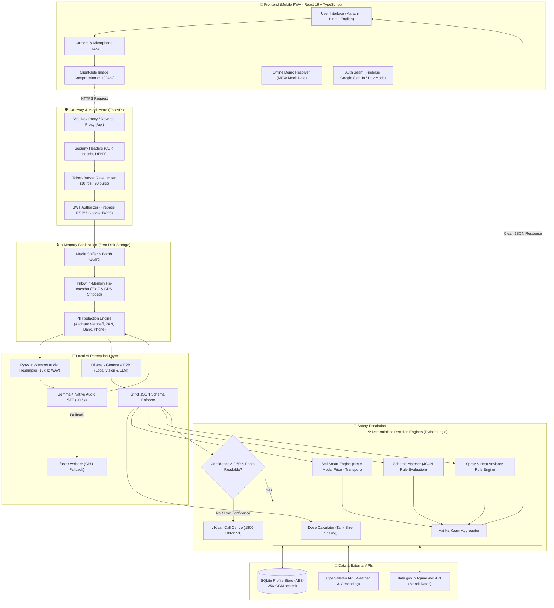

# Arth — अर्थ

> **Daily farming decisions for smallholder farmers in Maharashtra — in Marathi, Hindi, and English.**

[](LICENSE)
[](frontend/)
[](frontend/)
[](backend/)
[](backend/)
[](https://ollama.com)
[](backend/tests/)
[](#privacy--security-by-design)

---

## Table of Contents

- [Why Arth? (The Human Context)](#why-arth-the-human-context)
- [Core Safety Principle](#core-safety-principle)
- [Architecture Flow](#architecture-flow)
  - [1. High-Level Conceptual Flow (For Everyone)](#1-high-level-conceptual-flow-for-everyone)
  - [2. End-to-End Technical Pipeline](#2-end-to-end-technical-pipeline)
  - [3. Walkthrough of Real User Scenarios](#3-walkthrough-of-real-user-scenarios)
- [Core Features](#core-features)
- [Privacy & Security by Design](#privacy--security-by-design)
- [Repository Layout](#repository-layout)
- [Quickstart Guide](#quickstart-guide)
  - [Option A: Instant Offline Demo Mode (Zero Setup)](#option-a-instant-offline-demo-mode-zero-setup)
  - [Option B: Full-Stack Local Environment (FastAPI + Ollama Gemma 4)](#option-b-full-stack-local-environment-fastapi--ollama-gemma-4)
- [Testing & Quality Assurance](#testing--quality-assurance)
- [Data Sources & Acknowledgements](#data-sources--acknowledgements)
- [License](#license)

---

## Why Arth? (The Human Context)

Meet **Ramesh** — a farmer cultivating 2.5 acres in Niphad, Nashik growing grapes and onions.

Every morning, Ramesh faces critical agricultural decisions where mistakes cost weeks of income:
- **"Should I spray pesticide today?"**  
  *Without Arth:* He looks at the morning clouds and sprays; unexpected afternoon rain washes away ₹5,000 of pesticide and pollutes the ground.  
  *With Arth:* **Aaj Ka Kaam** checks 7-day weather forecasts and wind speeds, giving a clear advisory: *"Do not spray tomorrow — 80% rain predicted"*.
- **"What is this white spot on my grape leaves?"**  
  *Without Arth:* He travels to an agro-dealer in town who sells him an expensive, unneeded chemical.  
  *With Arth:* **Crop Doctor** photographs the leaf, diagnoses the disease (*Alternaria porri / Downy mildew*), and prescribes organic and chemical remedies. If uncertain, it directly connects him to the **Kisan Call Centre (1800-180-1551)**.
- **"How much pesticide do I mix in my 15-litre sprayer pump?"**  
  *Without Arth:* The bottle says *"mix 250 ml/acre in 200 L water"*. Mental math errors either burn the crop or fail to kill the pest.  
  *With Arth:* **Label Reader** extracts active ingredients, and a deterministic Python engine calculates the exact dosage for his 15-litre tank. **It never guesses.**
- **"Which mandi should I take my onions to?"**  
  *Without Arth:* He sells at the nearest market, losing profit to middlemen.  
  *With Arth:* **Sell Smart** calculates net earnings across all nearby APMCs after deducting vehicle transport costs:  
  $$\text{Net Earnings} = (\text{Modal Price} \times \text{Quantity}) - (\text{Distance in km} \times \text{Transport Cost per km})$$
- **"What does this official government or bank notice say?"**  
  *Without Arth:* Dense legal jargon in English or formal script creates anxiety and causes missed subsidy deadlines.  
  *With Arth:* **Kagaz Samjho** redacts Aadhaar, PAN, and bank account numbers, providing an instant plain-language summary with deadlines and action items in Marathi or Hindi.

---

## Core Safety Principle

> **"The model reads and explains; Python decides."**

Generative AI models are exceptional at **perception** (reading handwriting, recognizing leaf blights, transcribing rural dialects). However, they can hallucinate numbers. In agriculture, a hallucinated chemical dose or false market rate can devastate a family's livelihood.

Arth enforces strict architectural separation:
1. **AI Perception Layer (Gemma 4 & faster-whisper):** Responsible *only* for reading labels, recognizing crop symptoms, transcribing voice, and generating friendly explanations.
2. **Deterministic Domain Engines (Python Logic):** Responsible for all calculations — sprayer tank dosage math, mandi transport profitability, crop calendar matching, and scheme eligibility rules.
3. **Safety Fallback:** If image confidence is below $0.60$ or the label is blurry, Arth refuses to guess and connects the farmer to the official **Kisan Call Centre (`1800-180-1551`)**.

---

## Architecture Flow

### 1. High-Level Conceptual Flow (For Everyone)

```
[ 🧑‍🌾 Farmer (Phone / Voice / Camera) ]
                  │
                  ▼
[ 📱 Arth Mobile PWA (Marathi · Hindi · English) ]
                  │
                  ▼
[ 🛡️ Privacy Firewall (In-Memory EXIF Strip & Verhoeff Aadhaar Redaction) ]
                  │
        ┌─────────┴─────────┐
        ▼                   ▼
[ 🧠 AI Vision & STT ]  [ ⚙️ Python Math Engines ]
  (Gemma 4 & Whisper)     (Dose, Mandi Net, Schemes)
        │                   │
        └─────────┬─────────┘
                  ▼
[ ✅ Safe, Verified Advice + Kisan Call Centre (1800-180-1551) Fallback ]
```

---

### 2. End-to-End Technical Pipeline



---

### 3. Walkthrough of Real User Scenarios

#### Scenario A: Leaf Disease Diagnosis (`/doctor`)
1. **Intake:** The farmer takes a photo of a diseased onion leaf.
2. **Client Compression:** The browser downscales the image to $\le 1024\text{px}$ in memory using `browser-image-compression`.
3. **Privacy Sanitization:** FastAPI passes raw bytes to Pillow, which strips all EXIF metadata and GPS tags. The image is never written to disk.
4. **Model Perception:** Gemma 4 Vision detects symptoms (*Alternaria porri / Purple blotch*).
5. **Confidence Check:** If confidence $\ge 0.60$, it returns the diagnosis with organic and chemical remedies. If $< 0.60$ or blurry, it displays a one-tap call button for the Kisan Call Centre (`1800-180-1551`).

#### Scenario B: Pesticide Label & Sprayer Tank Dosage (`/label`)
1. **Intake:** The farmer photographs a bottle of *Mancozeb 75% WP*.
2. **Perception:** Gemma 4 Vision extracts active ingredients, dilution basis (`2.5 g per litre`), and safety guidelines into typed JSON.
3. **Deterministic Math:** `services/dose.py` multiplies $2.5\text{ g/L} \times 15\text{ L (farmer's tank size)} = 37.5\text{ grams}$.
4. **Result:** The UI displays **"Add 37.5 g per 15L tank"** along with safety instructions in Marathi/Hindi.

#### Scenario C: Mandi Sell Smart Decision (`/mandi`)
1. **Live Data:** Fetches today's APMC prices from data.gov.in Agmarknet and calculates distances from the farmer's village via Open-Meteo geocoding.
2. **Math Engine:** For each market, it calculates:
   $$\text{Net Earnings} = (\text{Modal Price} \times \text{Quantity}) - (\text{Distance in km} \times \text{Transport Cost per km})$$
3. **Recommendation:** If local prices are rising and net profits elsewhere are lower due to transport, it recommends **"WAIT"**; otherwise, it highlights the most profitable market and recommends **"SELL NOW"**.

#### Scenario D: Document Explainer with PII Redaction (`/kagaz`)
1. **Consent Gate:** Requires the farmer's explicit consent before processing.
2. **Redaction Engine:** Regex and the **Verhoeff algorithm** detect Aadhaar numbers, PAN cards, bank account numbers, and phone numbers.
3. **Masking:** Replaces sensitive values with `XXXX-XXXX-1234` before Gemma 4 analyzes the text.
4. **Summary:** Gemma 4 translates official terms into a 3-bullet summary with deadlines and action items in Marathi/Hindi.

---

## Core Features

| Feature | What It Does | Technology |
| :--- | :--- | :--- |
| **🌤️ Aaj Ka Kaam** *(Today's Work)* | Daily prioritized morning brief (spray advisories, mandi alerts, work items). | Open-Meteo + Agmarknet + Audio readout |
| **🌿 Crop Doctor** *(पीक डॉक्टर)* | Leaf disease diagnosis, severity rating, and remedies. | Gemma 4 Vision + Kisan Call Centre escalation |
| **🧪 Label Reader** *(डोस गणक)* | Exact chemical dose per sprayer pump (15L/16L). | Gemma 4 OCR + Python dosage engine |
| **📄 Kagaz Samjho** *(कागद समजून घ्या)* | Government/bank notice explainer with PII masking. | Verhoeff PII redactor + Gemma 4 translation |
| **📈 Mandi & Sell Smart** | Live APMC rates, 30-day trends, and transport-adjusted sell advice. | Agmarknet API + Recharts + Transport formula |
| **📅 Crop Calendar** | Season-aware cultivation plans (Kharif, Rabi, Zaid). | Regional agronomy rules + Soil/irrigation matching |
| **🏛️ Scheme Finder** | Wizard matching farmers to PM-Kisan, PMFBY, KCC, MahaDBT. | Rule-based engine + Voice-assisted form fill |
| **🎙️ Voice Assistant** | Hands-free voice queries in Marathi, Hindi, and English. | Gemma 4 Native Audio / Whisper + Gemma 4 intent routing |

---

## Privacy & Security by Design

1. **Zero Storage of Media:** Photos and voice clips are decoded in memory, processed, and discarded. No S3, cloud storage, or local disk persistence is used.
2. **EXIF & GPS Stripping:** All camera metadata and location coordinates are stripped in RAM before visual processing.
3. **Verhoeff-Validated PII Redaction:** Complete masking of Aadhaar (with checksum verification), PAN, IFSC, bank accounts, and mobile numbers.
4. **Encrypted Storage:** Profiles in SQLite are sealed with **AES-256-GCM** (row-bound with associated data). Primary keys use an HMAC hash of the user ID.
5. **30-Day TTL & Right to be Forgotten:** History records expire automatically after 30 days. Calling `DELETE /farmer/me` wipes all stored data and frontend cache.
6. **Local AI Execution:** When running Ollama and PyAV/Whisper, all inference occurs locally on your machine with zero third-party cloud data leaks.

---

## Repository Layout

```
Arth/
├── frontend/                     # Mobile-first React 19 PWA
│   ├── src/
│   │   ├── app/                 # Router, layout shell, bottom nav
│   │   ├── features/            # Feature modules (brief, doctor, label, mandi, kagaz, etc.)
│   │   ├── components/ui/       # Tactile UI components (Rutu design tokens)
│   │   ├── lib/                 # API client, session management, Firebase auth
│   │   ├── mocks/               # MSW mock handlers & Ramesh demo data
│   │   └── i18n/                # Localization files (en, hi, mr)
│   ├── public/                  # PWA manifest, service worker assets
│   ├── README.md                # Frontend documentation
│   └── package.json
├── backend/                      # FastAPI Python Service
│   ├── app/
│   │   ├── main.py              # Application factory, lifespan, CORS, rate limiting
│   │   ├── auth.py              # Firebase JWT verification & dev auth bypass
│   │   ├── db.py                # AES-256-GCM encrypted SQLite persistence
│   │   ├── llm.py               # Ollama Gemma 4 client with JSON schema validation
│   │   ├── stt.py               # Gemma 4 native audio + PyAV + faster-whisper fallback
│   │   ├── pii.py               # Verhoeff Aadhaar, PAN, IFSC & phone redactor
│   │   ├── media.py             # In-memory image sanitization & EXIF stripping
│   │   └── services/            # Pure Python business rules (dose, mandi, schemes, etc.)
│   ├── tests/                   # 176 pytest unit and integration tests
│   ├── README.md                # Detailed backend documentation
│   └── pyproject.toml
└── docs/
    └── SPEC.md                  # Comprehensive API contract, security, and UX specification
```

---

## Quickstart Guide

### Option A: Instant Offline Demo Mode (Zero Setup)

You can run and explore the full UI in offline demo mode without installing Python, Ollama, or external API keys. The demo preloads data for **Ramesh**, an onion and grape farmer from Niphad, Nashik.

```bash
# 1. Navigate to frontend
cd frontend

# 2. Install dependencies
npm install

# 3. Configure environment for mock mode
cp .env.example .env.local
# (Ensure VITE_USE_MOCKS=true in .env.local)

# 4. Start Vite development server
npm run dev
```

Open `http://localhost:5173` in your browser and click **"Try demo without signing in"**.

---

### Option B: Full-Stack Local Environment (FastAPI + Ollama Gemma 4)

#### Prerequisites
- **Node.js** 20+ & **npm**
- **Python** 3.11–3.14
- **[Ollama](https://ollama.com)** with Gemma 4:
  ```bash
  ollama pull gemma4:e2b
  ```

#### 1. Start the FastAPI Backend
```bash
cd backend

# Create and activate virtual environment
python -m venv .venv
# On Windows (cmd/PowerShell):
.venv\Scripts\activate
# On macOS/Linux:
source .venv/bin/activate

# Install dependencies and dev tools
pip install -e ".[dev]"

# Configure environment
cp .env.example .env
# Set ARTH_AUTH_DISABLED=true for local dev without Firebase, or set ARTH_FIREBASE_PROJECT_ID

# Start FastAPI server on port 8000
uvicorn app.main:app_factory --factory --port 8000
```
Interactive API documentation is accessible at `http://localhost:8000/docs` (in development mode).

#### 2. Start the Frontend Connected to Backend
```bash
cd frontend

# In frontend/.env.local:
# VITE_USE_MOCKS=false
# VITE_DEV_SIGN_IN=true    (allows local sign-in without Firebase)
# VITE_API_BASE_URL=       (leave blank; Vite proxies /api to http://localhost:8000)

npm run dev
```

Open `http://localhost:5173`. The Vite proxy will route all `/api` calls directly to your FastAPI backend.

---

## Testing & Quality Assurance

### Frontend
```bash
cd frontend
npm run build   # Type-check and production build
npm run lint    # ESLint inspection
```

### Backend
The backend contains **176 automated tests** covering security, PII scrubbing, dosage math, and error handling without requiring a live Ollama model or internet access:

```bash
cd backend
pytest          # Runs all 176 tests
ruff check .    # Code style and security checks
```

---

## Data Sources & Acknowledgements

- **Design System:** Ported with appreciation from [Project Rutu](https://github.com/rushii23-dev/Project-Rutu) (color tokens, typography, cards, and bottom navigation).
- **AI Models:** [Gemma 4](https://ai.google.dev/gemma) (Google DeepMind) via [Ollama](https://ollama.com); [faster-whisper](https://github.com/SYSTRAN/faster-whisper) (MIT); [PyAV](https://github.com/PyAV-Org/PyAV).
- **Weather Forecasts:** [Open-Meteo](https://open-meteo.com) (CC BY 4.0).
- **Mandi Prices:** Directorate of Marketing & Inspection (DMI), Agmarknet via [data.gov.in](https://data.gov.in) (Government Open Data License – India).

---

## License

See [LICENSE](LICENSE) for details.
