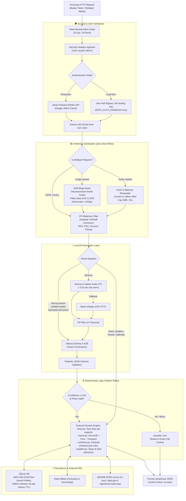

# Arth Backend Service

> **FastAPI backend service powering Arth (अर्थ) with local AI inference (Gemma 4 native vision & audio), zero-disk media processing, and privacy-first encrypted storage.**

[](app/)
[](pyproject.toml)
[](tests/)
[](https://ollama.com)
[](app/stt.py)
[](app/db.py)

---

## Overview

The Arth backend implements the full API contract specified in [docs/SPEC.md](../docs/SPEC.md) §3. It communicates with the frontend via typed, camelCase JSON endpoints.

All visual and speech AI runs **locally** on **Gemma 4 E2B via Ollama** (with native audio processing via PyAV and faster-whisper as a fallback), guaranteeing that farmers' photos, voice clips, and documents are processed purely in-memory and never leave the host machine.

### Design Philosophy
> **"The model reads and explains; Python decides."**  
> Gemma 4 extracts fields from images and documents as schema-validated JSON. All critical agricultural math — sprayer tank dilution rates (`services/dose.py`), scheme eligibility rules (`services/schemes.py`), spray weather advisories (`services/weather.py`), and market net profitability (`services/mandi.py`) — is executed by pure, deterministic Python code. When confidence is low ($< 0.60$) or an image is degraded, the service flags `escalate: true` to refer the farmer to the Kisan Call Centre (`1800-180-1551`).

---

## Backend Architecture Flow



---

## API Endpoints Summary

| Endpoint | Method | Description | Processing Model |
| :--- | :---: | :--- | :--- |
| `/api/farmer/me` | `GET` | Retrieve encrypted farmer profile | AES-256-GCM decrypted SQLite fetch |
| `/api/farmer/me` | `PUT` | Create or update farmer profile | AES-256-GCM sealed row keyed by HMAC(UID) |
| `/api/farmer/me` | `DELETE` | Erase profile and all history records | Atomic deletion of profile + history (30-day TTL) |
| `/api/brief` | `GET` | Today's prioritized tasks (*Aaj Ka Kaam*) | Aggregates weather advisories, mandi alerts, calendar |
| `/api/weather` | `GET` | 7-day forecast & agricultural advisories | Open-Meteo API (15-min cache) + spray rule engine |
| `/api/mandi/prices` | `GET` | Nearby APMC prices and 30-day trend | MSAMB public APMC grid (no key) or data.gov.in Agmarknet (with key) + local trend tracking |
| `/api/mandi/sell-advice` | `POST` | Net profitability calculation | Net = $(\text{Price} \times \text{Qty}) - \text{Transport}$; Gemma explains |
| `/api/ai/crop-doctor` | `POST` | Disease diagnosis from leaf photo | Gemma 4 Vision $\to$ symptoms/treatments; fallback escalation |
| `/api/ai/label-reader` | `POST` | Pesticide dose per sprayer tank | Gemma extracts label text; Python computes tank dose |
| `/api/ai/explain-document`| `POST` | Plain-language document summary | PII redaction $\to$ Gemma explains; requires `consent=true` |
| `/api/ai/voice` | `POST` | Trilingual voice assistant | Gemma 4 Native Audio $\to$ PII scrub $\to$ Gemma intent extractor |
| `/api/calendar` | `GET` | Crop calendar & weekly task timeline | Rule-based matching against soil, irrigation, and season |
| `/api/schemes/match` | `POST` | Government scheme eligibility matching | Evaluates farmer criteria against rules in `schemes.json` |
| `/api/health` | `GET` | Service & Ollama model health check | Verifies Ollama connectivity and model loading |

---

## Local Setup & Execution

### Prerequisites
- **Python:** 3.11 – 3.14
- **[Ollama](https://ollama.com):** Installed with Gemma 4 E2B:
  ```bash
  ollama pull gemma4:e2b
  ```
- **GPU:** ~8 GB VRAM recommended for fast inference (runs on CPU as fallback).

### Installation Steps

1. **Set Up Python Environment:**
   ```bash
   cd backend
   python -m venv .venv
   
   # Activate environment
   # Windows (PowerShell):
   .venv\Scripts\Activate.ps1
   # macOS / Linux:
   source .venv/bin/activate

   # Install package in editable mode with test dependencies
   pip install -e ".[dev]"
   ```

2. **Configure Environment Variables:**
   ```bash
   cp .env.example .env
   ```
   Edit `.env` to configure desired authentication mode:
   - **For local dev without Firebase:** Set `ARTH_AUTH_DISABLED=true` (accepted only when `ARTH_ENV=development`).
   - **For real Firebase sign-in:** Set `ARTH_FIREBASE_PROJECT_ID=<your-project-id>`.
   - **Live mandi data works without a key** (MSAMB's public APMC price grid). Optionally set `ARTH_DATA_GOV_IN_API_KEY=<your-api-key>` (free from data.gov.in) to use Agmarknet instead.

3. **Start the FastAPI Server:**
   ```bash
   uvicorn app.main:app_factory --factory --port 8000 --reload
   ```

4. **Connect the Frontend:**
   In `frontend/.env.local`, fill in the four `VITE_FIREBASE_*` values (Google sign-in is the
   only way into the app) and leave `VITE_API_BASE_URL` blank to use the Vite `/api` proxy.
   Set `ARTH_FIREBASE_PROJECT_ID` here to the same Firebase project.
   When you run `npm run dev` in `frontend/`, all requests to `/api` are automatically proxied to `http://localhost:8000`.

---

## Farm context without asking (`services/farm.py`, `services/calendar.py`)

- **Soil is never asked.** `PUT /farmer/me` fills `soilType` from the district (nearest of 36
  Maharashtra district centres, or the named district) unless `soilSource` is `"farmer"`.
- **`GET /soil`** returns the district's Soil Health Card results (share of tested fields low in
  N, P, K, organic carbon; share deficient in S, Zn, B, Fe) with plain-language tips that say
  these are district odds, not the farmer's field.
- **`GET /calendar`** works from today's date (IST) when no `season` is given: the season and its
  progress, the farmer's crops and their usual stage today (`data/crop_stages.json`), every
  sowing window's status (open with days left, or upcoming), kharif windows moved to the
  district's monsoon onset (IMD 1985–2025), and "why now" lines from the live forecast, live
  mandi prices and the soil data.
- **`GET /brief`** adds the weather right now, the place, the crops in the field today and the
  season progress; crop-stage jobs feed the 2–3 actions.
- District data: `data/districts.json`, rebuilt with `python scripts/build_districts.py <Project-Rutu checkout>`.

---

## Security & Privacy Architecture

- **Firebase JWT Verification (`auth.py`):**  
  Follows Firebase specification: RS256 algorithm pinning, Google's public keys fetched via JWKS and cached with `Cache-Control` awareness (and cached to disk for offline resilience). User identity is read **only** from the cryptographically verified `sub` claim.
- **Sealed Storage (`db.py`):**  
  Farmer profiles are encrypted with **AES-256-GCM** using row-bound associated data. Database primary keys use an HMAC hash of the UID, making raw user IDs absent from database tables.
- **In-Memory Media Lifecyle (`media.py` & `stt.py`):**  
  Uploaded images and audio files are never written to disk or S3. Images are sniffed by magic bytes, protected against decompression bombs, stripped of all EXIF/GPS tags via Pillow, and re-encoded. Audio is converted to 16 kHz mono WAV in memory via PyAV and decoded strictly in RAM.
- **Aadhaar & PII Redaction (`pii.py`):**  
  Detects and replaces Aadhaar numbers (verified via **Verhoeff checksum** algorithm), Indian mobile numbers, PAN numbers, IFSC codes, bank account numbers, and email addresses with masked identifiers (`XXXX-XXXX-1234`).
- **HTTP Hardening (`middleware.py`):**  
  - Token-bucket rate limiter ($10\text{ rps}$, burst of $20$).
  - Strict Content Security Policy (CSP), `X-Frame-Options: DENY`, `X-Content-Type-Options: nosniff`.
  - Sensitive routes enforce `Cache-Control: no-store`.
  - Body size caps enforced at both `Content-Length` and streamed byte reader levels.

---

## Testing & Code Quality

The backend test suite contains **203 automated tests** that run without requiring an active Ollama instance or external network access (all network calls and model responses are mocked with realistic fixtures):

```bash
# Run full test suite
pytest

# Run tests with coverage summary
pytest --cov=app

# Run linter and security checks
ruff check .
```

---

## Data Sources & Licenses

| Dependency / Service | License / Usage | Role in Arth |
| :--- | :--- | :--- |
| **Gemma 4 E2B** (Google DeepMind) | Apache-2.0 via Ollama | Visual disease diagnosis, label extraction, document explanation, native audio |
| **PyAV** | BSD-3-Clause | In-memory audio decoding and resampling |
| **faster-whisper** | MIT | Speech-to-Text transcription fallback |
| **FastAPI / Pydantic / Uvicorn** | MIT | High-performance asynchronous REST API framework |
| **Cryptography** | Apache-2.0 / BSD | AES-256-GCM row-bound database encryption |
| **Pillow** | HPND (MIT-CMU) | In-memory image sanitization, EXIF scrubbing, and resizing |
| **Open-Meteo** | CC BY 4.0 | Real-time weather forecasting and reverse geocoding |
| **MSAMB (msamb.com)** | Public data published by the Maharashtra State Agricultural Marketing Board | Daily APMC arrivals and prices, last 7 days (default, no key) |
| **Agmarknet via data.gov.in** | Government Open Data License – India | Daily mandi arrival prices across Maharashtra APMCs (when a key is set) |

For overall project documentation, see the [Root README](../README.md).
